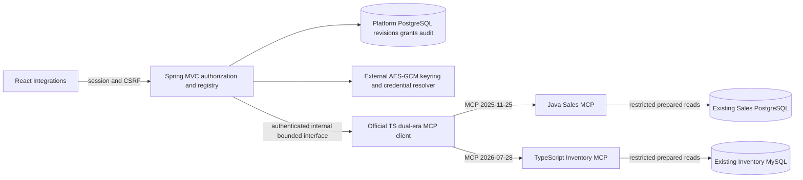
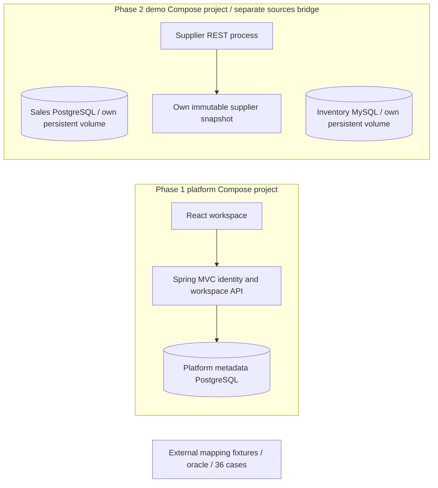
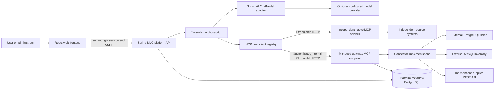
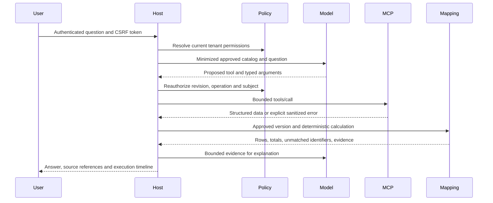

# Architecture

Status: target architecture established in Phase 0; updated 2026-10-30 for implemented Phases 1-2. The diagrams below include later-phase components. Phase 1 implements only identity, organizations, authorization, web and observability packages, platform PostgreSQL/Flyway and the React workspace. Phase 2 adds three independent demo sources and external mapping/oracle/case artifacts. Updated 2026-10-31: Phase 3 now implements native MCP registration, explicit approvals and manual invocation; managed gateway/connectors/AI, platform mapping management and benchmark execution remain unimplemented. See the implemented Phase 3 boundary below. See [ADR 0006](decisions/0006-phase1-identity-and-local-stack.md) for actual Phase 1 boundaries. Decisions: [0001](decisions/0001-modular-platform.md), [0002](decisions/0002-supported-dependencies.md), [0003](decisions/0003-mcp-and-gateway.md), [0004](decisions/0004-security-and-mappings.md), [0005](decisions/0005-delivery-and-evaluation.md).

## Implemented Phase 3 boundary (2026-10-31)

Java owns actor/org authorization, immutable configuration revisions, encrypted credential references, approval fingerprints, CAS lifecycle and sanitized audit. The replaceable NativeMcpClient port hides the additional Node process. The official-SDK adapter owns bounded transient connections keyed by organization/integration/revision; it is not the future managed connector gateway. No global Spring AI callback catalog or model dependency exists. Boot 4.1.2 / Spring AI 2.0.2 remain unchanged.

The explicit MCP override joins the backend to MCP control and its metadata network. The adapter is control-only; native servers alone join the original source network. Default platform/demo Compose definitions and persistent volumes remain intact. Dynamic registration accepts operator-permitted endpoints without hardcoding their tools in Java or React. One backend replica and bearer authentication are the Phase 3 deployment scope. See [integrations](MCP_INTEGRATIONS.md), [compatibility](MCP_COMPATIBILITY.md), [security](MCP_SECURITY.md), and ADRs [0008](decisions/0008-mcp-dual-era-client.md), [0009](decisions/0009-native-mcp-registry.md), [0010](decisions/0010-native-source-mcp-servers.md), [0011](decisions/0011-mcp-credentials-and-destinations.md). [Verification](../development/PHASE_3_VERIFICATION.md) records actual results and remaining acceptance work.

## Implemented deployment boundaries (Phases 1-2)

There is no runtime connection between the platform and these source systems. Each source runs without another source, the platform or evaluation files. Local verification scripts read their explicit test contracts; they are not platform connectors. [Demo architecture](DEMO_ECOSYSTEM.md) and [ADR 0007](decisions/0007-independent-demo-ecosystem.md) define ownership and future explicit network access.

## Target context and deployment boundaries (later phases)

The platform backend initially includes the managed gateway as a bounded module and a dedicated internal MCP endpoint. It is one deployment, not a separate microservice. Its client-to-server path still uses the supported SDK transport over authenticated loopback/internal HTTP; invoking connector methods directly from chat would bypass the intended MCP boundary. Integration tests must exercise the wire path. If resource or security isolation requires a separate deployment, an ADR will extract the gateway using its existing interfaces. Native MCP demo servers remain independently deployable from the start.

The browser never connects to external databases, receives integration secrets, or calls remote MCP servers directly. Model providers see only authorized, minimized tool definitions and evidence. No paid model is necessary for startup or ordinary tests. In no-model mode chat reports unavailable; it must not fabricate an answer.

## Main platform module contracts

One Maven application with packages under `io.ecosync`; add separate build modules only when boundaries justify them. Expose module application interfaces/DTOs; repository classes and ORM entities stay private to their module. Use architecture dependency tests in the skeleton rather than creating empty packages merely to match this table.

| Boundary | Owns | Permitted collaborators |
| --- | --- | --- |
| identity | Local user auth, sessions, controlled admin provisioning | organizations, authorization, audit |
| organizations | Tenant membership and tenant-scoped lookup contracts | No integration/orchestration internals |
| authorization | Role, integration and tool policy evaluation | identity/organization read contracts; no connector I/O |
| integrations | Registrations, immutable config revisions, lifecycle, tool approval | authorization, credential store interface, audit; schedules discovery through MCP/connector contracts |
| connectors | PostgreSQL, MySQL, REST validation/inspection/execution | Credential and outbound policy interfaces; no model or chat dependencies |
| mcp | Native clients, gateway server adapter, protocol negotiation, namespacing | integration/authorization read contracts; connector execution contract for gateway |
| ai | Replaceable Spring AI model adapter and provider settings | Tool/result DTOs only; no DB credentials or connector implementations |
| orchestration | Bounded execution state machine, tool validation and dispatch | authorization, integration/tool catalog, MCP invocation, ai, mapping, audit |
| mapping | Approved canonical IDs, transforms, deterministic joins/calculations | Source/schema references and structured data; no model dependency |
| audit | Append-only sanitized events and restricted query API | Tenant and actor IDs; no dependency on business implementation classes |
| observability | Health, metrics, tracing and correlation | Technical instrumentation with payload redaction |
| evaluation | Versioned cases, run manifests and metrics | Public application execution contracts, independent expected-answer oracle |

Avoid a module cycle by splitting registration metadata from connection lifecycle adapters: integrations publishes configuration-change events; MCP/gateway handlers observe them. Results return through explicit ports. Authorization depends on policy DTOs rather than integration repositories. No generic shared module should become a business-logic dumping ground.

## Integration registration, approval, and invalidation

1. Administrator chooses existing MCP, PostgreSQL, MySQL, or REST. These have distinct forms and validation semantics.
2. Save an immutable configuration revision as DRAFT, with secret references separated. Validate destination policy before any connection attempt.
3. A bounded validation/discovery job snapshots the revision and enters VALIDATING. Discover only permitted metadata. Handle paginated MCP tool lists with limits.
4. Present capability/schema fingerprints and scopes for review. Validating connectivity alone grants no invocation permission.
5. Administrator approves specific capabilities for specific roles/subjects. Activation requires successful validation of the same current revision and explicit approval.
6. Maintain ACTIVE or DEGRADED health. DISABLED excludes discovery/export and new calls, closes clients/pools, invalidates caches and cancels in-flight work where possible. Already-returned data cannot be recalled.
7. Config or schema changes invalidate affected approvals and derived tools; never silently expand access. A disabled integration stays disabled after editing until explicit validation and reactivation.

Transitions: DRAFT -> VALIDATING -> ACTIVE after approval, VALIDATING -> DRAFT on failure, ACTIVE -> DEGRADED on failed health, DEGRADED -> ACTIVE only if configuration/approvals are unchanged and health recovers. Any state may be explicitly disabled. Re-enablement goes through DRAFT/VALIDATING. Health does not override governance state. Compare-and-set revision checks prevent a late validation job from activating stale config.

## MCP and managed connector execution

Registry key: `(organizationId, integrationId, configurationVersion)`. Resolve clients at runtime from persisted registrations; application startup YAML alone does not meet dynamic onboarding requirements. Start with a uniform synchronous SDK client API and bounded worker pools; explicitly disable unused sampling, roots, elicitation and STDIO launch capabilities. Scope clients and callbacks per integration; do not export all discovered callbacks globally into a shared ChatClient.

Each published tool has an opaque stable alias derived from integration UUID plus operation UUID, a retained original remote name, validated schemas and a fingerprint. Do not use untrusted display names as dispatch keys. Enforce name length/format constraints of the selected SDK/provider. Tool descriptions and annotations cannot grant trust or permissions.

The SDK provides `McpSyncServer.addTool(...)` and `removeTool(...)`; the managed gateway will generate tool specifications from approved connector capabilities and register/unregister them at runtime. Spring's static annotated tools remain suitable for independent demo services, not dynamic customer connections. See [compatibility evidence](COMPATIBILITY.md).

Connector contract (conceptual, no Java interface implemented yet): validate typed configuration; test bounded connectivity; inspect allowlisted schemas/capabilities; describe approved operations; execute validated operation; return structured result/error; report health; close resources. Lookup implementations by explicit connector type, not giant switches in the orchestrator. Adding another supported connection is configuration; a new protocol requires an adapter.

For each managed invocation the host mints a short-lived internal delegated context bound to actor, org, integration revision, operation, execution ID, expiry and audience. Authenticate the host service separately. The gateway verifies both, checks current approval/revocation and refuses a browser session as a substitute. Credentials are resolved only inside the connector. No tenant identity or permission from model arguments is trusted. Restrict endpoint routing/Origin, never publish its port externally by default, and protect it even on loopback. Do not forward browser, GitHub, or external-system bearer tokens as delegation credentials.

## Query execution and provenance

Proposed starting limits: 30s total deadline, 8 tool calls, 4 concurrent calls, 5s connect timeout, 10s tool timeout capped by remaining deadline, 100 rows by default/500 maximum, 1 MiB per tool response and 2 MiB aggregate evidence. At most one transient retry for an idempotent read, charged against call/time budget. Enforce byte limits while streaming; truncation and partial failures are explicit. These are initial policy defaults to measure, not benchmark results.

Execution status distinguishes COMPLETED, PARTIAL, FAILED, CANCELLED. Evidence records integration/config version, tool/schema fingerprint, operation parameters with sensitive fields removed, source record identifiers, retrieval time, explicit UTC time range, mapping version and deterministic calculations. Report unknown or conflicting data. No inferred identifier equivalence, currency conversion or hidden chain of thought. Phase 6 may use explicitly seeded approved mappings; Phase 7 adds general mapping management.

## Repository layout by introduction phase

| Path | Phase | Purpose |
| --- | --- | --- |
| `config/versions.json`, `scripts/`, `docs/` and root planning files | 0 | Pins, compatibility/documentation verification and design |
| `backend/`, `frontend/`, `infra/docker/`, `.github/workflows/` | 1 | Main platform, initial local stack and CI |
| `demo-systems/sales/`, `demo-systems/inventory/`, `demo-systems/suppliers/`, `evaluation/datasets/` | 2 | Independent systems and reproducible synthetic data |
| `mcp-servers/`, gateway module inside `backend/` | 3-4 | Native servers and runtime-managed connector tools |
| `evaluation/` execution/results tooling | 9 | Benchmarks, run manifests and measured reports |
| `infra/kubernetes/`, isolated `infra/gitops/` fallback, `infra/argocd/` | 10 | Kustomize sources, desired environment state and Argo bootstrap; prefer a separate GitOps repo when provisioned |

Do not create the future empty directories now. Backend is Spring MVC/JPA for metadata, JDBC for controlled external reads. PostgreSQL metadata is distinct from demo PostgreSQL even when local containers share a host. React uses strict TypeScript, React Query, React Router and accessible Radix primitives with a small CSS token system. Evaluate errors, focus states and real empty data explicitly.
