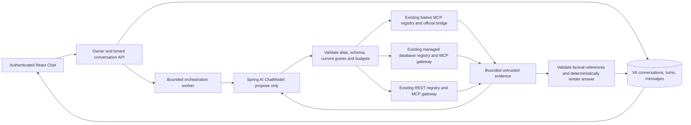

# Controlled chat orchestration

Phase 6 implementation on `codex/phase-6-llm-cross-system-chat`; final acceptance is recorded separately in [verification](../development/PHASE_6_VERIFICATION.md). [ADR 0014](decisions/0014-controlled-chat-orchestration.md) records the trust boundaries. Boot 4.1.2, Spring AI 2.0.2, Java 21 and MCP SDK 2.1.0 remain pinned.

## Request lifecycle

Spring AI translates messages/tool definitions to the local provider and translates its response back to `AssistantMessage`. Direct `ChatModel.call` is used, without a ChatClient advisor loop. Definition-only callbacks throw if invoked automatically. The model can propose an alias and JSON arguments; it cannot execute a registry, choose an actor, provide a delegation token or supply a destination/SQL/header override. `ChatCapabilities` invokes the existing native/database/REST registry methods with the session actor. Those registries perform their own authorization and real MCP execution unchanged.

Catalog aliases bind immutable entity IDs, connector IDs, revisions and approval fingerprints. Database definitions include only approved columns. REST definitions include only approved GET parameter schemas. Native tools additionally require an explicit operator read-only declaration because the existing native fixtures do not advertise a read-only annotation. This declaration is not a substitute for source-side restricted credentials. Fresh checks target the exact capability; no permission TTL/cache is introduced.

## Persistent scope and state

V6 adds `chat_conversation`, `chat_turn`, `chat_message`. Composite organization/conversation/owner foreign keys and server checks enforce ownership. Integration administrators do not acquire access to other users' conversations. The session supplies actor identity; body identity fields are rejected. A turn reserves two ordered message positions under a conversation row lock. A unique owner/request ID prevents duplicate execution; a partial unique index permits only one RUNNING turn per conversation. A repeated request must match conversation and input hash.

Create/list/retrieve, send, cancel and archive use `/api/organizations/{org}/chat`. All unsafe methods use the existing CSRF mechanism. Archive is logical retention, not physical erasure. Startup marks incomplete turns INTERRUPTED. Cancellation first persists a terminal fence; a late worker cannot replace it with success. Source cancellation is best effort and cannot undo a request already received remotely. One authority replica is supported.

Statuses: COMPLETE means the selected supported evidence is grounded with no observed failure/truncation; PARTIAL means observed source failure/truncation prevents completeness; AMBIGUOUS means a requested relationship is not proven; CLARIFICATION_REQUIRED requests missing user scope without inventing facts; FAILED, TIMEOUT, CANCELLED and INTERRUPTED are explicit terminal execution outcomes. Empty successful data is not a source outage.

## Budgets and evidence

| Resource | Default / hard upper bound |
|---|---|
| End-to-end monotonic query deadline | 30 seconds / 30; operator may reduce to 1 second |
| Tool calls across the whole turn | 8 / 8, including deterministic helpers |
| Model rounds | 6 / 9 |
| Source catalog | 32 capabilities, then three bounded deterministic helper definitions |
| Context | 65,536 UTF-8 JSON bytes; operator minimum 4,096 |
| Current-turn evidence | 16,384 bytes; operator minimum 1,024 |
| Model proposal | 8,192 bytes; local generation at most 512 tokens |
| User input / request envelope | 4,000 characters / 20,000 bytes; duplicate JSON keys rejected |
| Conversation storage | 64 total conversations per owner/organization including archives; at most 100 turns/200 messages each |
| Factual references | Eight; each rendered value at most 2,000 characters; assistant message at most 16 KiB |
| Query workers | Four running plus four queued |
| Model/source operation workers | Eight, no waiting queue |

The deadline covers catalog/context/model/source/result/synthesis work, not just source calls. Remaining scope limits the existing HTTP/MCP waits and is checked again before dispatch. The outer future, cancellation and persisted state fence prevent late delivery. Existing source-side query/socket limits still bound already admitted remote work. There are no automatic orchestration/source retries. A local model's cold load can exceed the deadline and must fail honestly.

Evidence includes source identity, connector/revision/operation/tool, retrieval time, correlation, status and truncation. Source payloads are normalized/redacted/bounded before model exposure. The model's final JSON selects actual evidence IDs/pointers; arbitrary prose facts and invented numeric values are rejected. The server renders the selected actual values. This deliberately limits free-form synthesis: semantic correctness of a fluent paragraph is not established by a prompt. Source facts, deterministic helpers and missing evidence remain distinguishable.

Only user messages, final bounded answers, dependencies and bounded provenance/identifier references persist. Raw source payloads are query-local. Follow-ups reuse six recent user messages and up to three small currently authorized reference summaries, then retrieve fresh facts. Earlier source-derived answers/provenance are hidden on retrieval if current membership/grants/revision/semantic bindings fail. Browser copies of information already delivered cannot be recalled.

## Mappings and deterministic work

`chat/relationships-v1.json` is a byte-preserved copy of the explicitly authorized seeded mapping artifact, version 1.0.0. No held-out questions/answers are part of runtime context. Only a unique APPROVED relationship can authorize identity. Unknown, conflicting, ambiguous and incompatible records cannot establish a join.

An operator file binds exact organization/kind/connector/entity/revision/schema fingerprint to a canonical source and reviewed identifier paths. Its semantic fingerprint is included in conversation dependencies. Matching labels never establish identity. Native and database access to the same Sales fixture share the explicitly verified canonical `sales` identity; unverified identities are marked as such and cannot silently authorize a cross-system join. General mapping management and fuzzy matching remain Phase 7.

`approved_mapping` reads only seeded, permission-scoped metadata. `decimal_calculation` supports exact SUM/DIFFERENCE over actual evidence values with operator-reviewed currency/unit fields; it rejects incompatible or unverified measures and does not accept invented operands. `select_records` applies bounded scalar/date/decimal predicates to actual returned rows, for example quantity bounds on offers already filtered by currency, unit, supplier activity and validity. It cannot create rows or contact a source. No multiplication, currency conversion, unit conversion or arbitrary expressions are exposed.

Relationship proofs must use the cited evidence and its derivation inputs, not an unrelated retrieved row. Broad multi-entity results can remain AMBIGUOUS rather than claiming an unproven join. Truncation is conservative; fetching another page does not automatically prove overall completeness.

## Provider and implementation map

Default `AI_ENABLED=false`; no model or credentials are required. Optional Ollama uses only explicit local endpoints and verifies the configured model's manifest digest before each proposal. No cloud fallback or automatic pull is installed. The verification provider requires the explicit `chat-verification` profile and `AI_PROVIDER=verification`; current and historical UI responses identify it as a test double.

Core: `chat/ChatService`, `ChatCapabilities`, `ChatKnowledge`, `EvidenceGrounding`, `ChatBindings`, `OllamaModelPort`, `QueryBudget`, and independent `execution/CallDeadline`. React: `Chat.tsx`, React Query and the existing design system. [Local commands](../development/AI_LOCAL_SETUP.md), [security](AI_SECURITY.md), [acceptance](../development/PHASE_6_ACCEPTANCE.md).
