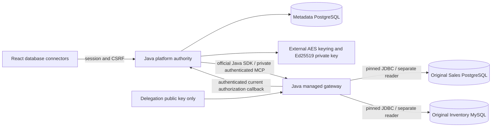

# Managed database connectors

Phase 4 implements a separate database control plane and private managed MCP data plane; final acceptance is tracked in [verification](../development/PHASE_4_VERIFICATION.md). Native MCP registration and the original independently owned source servers remain separate. Supplier REST, AI/model execution and general joins are excluded.

## Boundaries and catalog



The backend does not join the source network. The gateway has no platform PostgreSQL connection or AES/private signing key. Backend resolves connection material only after current authorization; the gateway retains it only in bounded connection resources. This process is a deliberately trusted data plane, separate from the Phase 3 TypeScript **client** adapter. [ADR 0012](decisions/0012-managed-gateway-and-database-boundary.md) supersedes the earlier in-process deployment proposal.

The stable Java SDK 2.1.0 serves tested Streamable HTTP Tools with MCP **2025-11-25**. It does not serve the modern 2026-07-28 gateway protocol. Existing native servers continue to serve their respective tested generations. A filtered neutral catalog contains `database_describe_table` and `database_read_rows`. It never embeds tenant connection/table/column names. Tool listing consults live authority for that caller; every call independently checks exact actor, organization, connector, revision, table UUID and role/scope grant. Global registration is only a transport optimization. Runtime add/remove and startup/periodic reconstruction derive from persisted authority.

Stable SDK change notifications are unfiltered per session; production disables them (`listChanged=false`) to avoid cross-tenant activity disclosure. Clients explicitly refresh. The disposable gate separately proves notification support. A failed reconcile hides the catalog and retires resources; it cannot create a grant. DRAFT inspection resource retention is deliberately distinct from ACTIVE approved tool visibility.

## Persistence and lifecycle

V4 adds `database_connector`, `database_configuration`, `database_credential`, `database_table`, `database_approval`, and `database_event`. Configurations are immutable and runtime grants permit SELECT/INSERT only. Tenant composite foreign keys bind credentials/configurations/tables/approvals. Native V1-V3 migrations are unchanged.

Register DRAFT → test/inspect VALIDATING → DRAFT/HEALTHY → explicitly approve selected columns for INTEGRATION_ADMIN/USER → explicitly ACTIVE. Health is independently UNKNOWN/HEALTHY/UNREACHABLE. AUDITOR inspects metadata/history without execution; global platform administration has no membership bypass. Discovery never approves. Primary-key columns must be included in each scope so pagination can have deterministic tie-breakers.

Editing creates a new configuration revision, revokes replaced credentials, stales old grants and retires old connections. Schema drift stales affected table grants and requires inspection/review. Changing an already approved column scope requires reinspection and explicit approval. Revoke/disable persist the admission fence before cleanup. Disable retains evidence; remove additionally revokes the current credential and hides the registration. Re-enabling uses a new revision and explicit inspection/approval/activation. Failed connectivity does not reactivate governance. Matching metadata fingerprints retain table UUIDs; changed metadata creates a new identity with no implicit grants.

The gateway obtains fresh permission before dispatch and before releasing results. The backend independently rechecks and commits completion under the same local governance lock, with a RUNNING→SUCCESS compare-and-set. Cancellation, disable, revision replacement and stale metadata prevent late results from committing successfully. Already admitted source reads cannot be undone. Cancellation is best effort at JDBC/network boundaries. One backend replica is supported; no distributed admission or horizontal scalability is claimed.

## Query contract

The browser posts to `/api/organizations/{org}/database-connectors/{id}/tables/{table}/query`:

```json
{
  "invocationId": "b54f32f7-06b6-4d34-a278-7d85e452a226",
  "query": {
    "columns": ["product_id", "product_name"],
    "filters": [{"column":"product_id","operator":"EQ","value":"1001"}],
    "order": [{"column":"product_id","direction":"ASC"}],
    "limit": 20,
    "offset": 0
  }
}
```

No SQL strings, JDBC URLs, driver properties, actor/org/role claims, functions or joins are accepted. Opaque connector/table UUIDs and revision are added by backend to MCP arguments, not taken from ordinary query fields. Identifier strings are accepted only after matching the current approved metadata, then dialect-quoted. Every value, including limit/offset, is a prepared parameter. A filter payload that resembles SQL remains a literal value; it is not interpreted as a command.

Operators: EQ, NE, LT, LTE, GT, GTE, IS_NULL, IS_NOT_NULL. Null operators omit `value`. Numeric values are decimal text, booleans are JSON booleans, dates are ISO dates and timestamps use UTC `Z`; UUID values are validated. Unsupported JDBC types cannot be approved. No automatic currency/unit conversion or cross-system aggregation is performed. Ordering uses approved columns plus every primary-key column as deterministic tie-breakers. Offset pagination is bounded and is not a snapshot guarantee if external data changes between requests.

The describe endpoint substitutes `/describe` and returns only the caller's approved columns, primary key and fingerprint. `/gateway-tools` performs actual authenticated MCP discovery. All returned descriptions/rows remain untrusted data and React renders them as text. Results include row count, truncation, cell truncation, byte-limit partial state, next bounded offset, retrieval time, revision, protocol, duration and correlation ID. Errors expose fixed classifications, never SQL, credentials or driver exception messages. Audit persists metadata only, not query arguments/results.

## Operational bounds

| Resource | Bound |
|---|---|
| Nonremoved registrations | 64 per deployment |
| Live pools / pool connections | 16 / 2 each; no minimum idle; idle retirement 1 minute; max lifetime 2 minutes |
| Executing operations | 8 global / 2 per connector, fail-fast |
| DNS | 2-second caller budget; 4 workers and 4 queued tasks; canceled late resolution cannot dispatch SQL |
| Connect / socket / SQL / gateway operation | 3 / 5 / 4 / 12 seconds; cancellation best effort in driver work |
| Internal authority callback | 3 seconds; bounded 64 KiB body |
| Metadata | 4 schemas, 64 tables, 64 columns/table, 512 total columns, 64 imported-key rows/table, 256 KiB snapshot |
| Structured arguments / management body | 16 KiB / 64 KiB |
| Selected columns / filters / requested ordering | 20 / 8 / 3; primary-key tie-breakers appended |
| Rows / offset | default 50, maximum 100; offset ≤10000; one extra row probes truncation |
| Text cell / encoded result | 2048 characters / 256 KiB row budget; explicit flags/partial state |
| MCP response / sessions | 512 KiB / 64 short-lived assertion-bound sessions; authenticated GET streams capped at 30 seconds |

The official backend client bounds each initialize/call operation separately; a cold HTTP API request can involve more than one such stage. These are implementation limits, not measured performance claims. Driver workers may outlive cancellation while their socket/deadline machinery closes; they cannot authorize a new dispatch without the current operation/authority fences.

## JDBC and network policy

Tested target engines are PostgreSQL 17.11 and MySQL 8.4.13. The gateway uses pgJDBC 42.7.14 and Connector/J 26.10.0, independently of the platform's metadata driver. Current vendor [PostgreSQL security/release information](https://jdbc.postgresql.org/security/), [MySQL release notes](https://dev.mysql.com/doc/relnotes/connector-j/en/news-26-10-0.html), and [compatibility](https://dev.mysql.com/doc/connector-j/en/connector-j-versions.html) were reviewed before selection. Only actual tested pins belong in `config/versions.json`.

Operator tuples fix database family, canonical host, port, database, schema and TLS/development mode. Tenant administrators cannot expand them. Resolve and check every address at admission/socket creation, reject metadata/link-local/loopback/reserved addresses, require explicit operator CIDRs for private destinations, and pin the first complete address set until operator restart. A changed DNS set fails closed and retires old resources. Original JDBC hostname remains intact for TLS verification while custom socket factories connect only to validated addresses.

Production requires PostgreSQL `sslmode=verify-full` with the JVM trust store, or MySQL `sslMode=VERIFY_IDENTITY`. Operators provision trust material outside Git; the UI cannot supply factories, arbitrary properties or trust overrides. Development plaintext is confined to exact named source destinations. MySQL public-key retrieval is enabled only for that development plaintext path, disabled with verified TLS. Multiple statements, local infile, URL infile and deserialization are disabled. PostgreSQL read-only/statement/lock settings and MySQL read-only transactions/optimizer deadline supplement actual database grants. Every driver property is normalized to String before Hikari construction; tests verify the drivers' parsed security/time-limit values.

Separate `gateway_sales_reader` and `gateway_inventory_reader` accounts receive SELECT only on the original business tables, not migration history or administrative tables. Existing native reader accounts, source migrations and fixture data are preserved. JDBC metadata excludes system schemas and migration-history tables and fetches no sample rows. Fingerprints cover discovered column type/precision/scale/nullability/ordinal, PK and bounded imported-key structure; this is not an exhaustive engine-specific DDL diff.

The dedicated gateway project joins source and its private control network. The explicit platform override adds only that control network to backend. No gateway host port is published; its public readiness is status-only. Containers are non-root, read-only with tmpfs, resource bounds and dropped capabilities. Original platform/demo/native Compose paths continue to work without the database gateway.

See [local setup](../development/DATABASE_LOCAL_SETUP.md), [security](DATABASE_SECURITY.md), [ADR](decisions/0012-managed-gateway-and-database-boundary.md) and [verification](../development/PHASE_4_VERIFICATION.md) for the actual evidence and remaining acceptance work.
