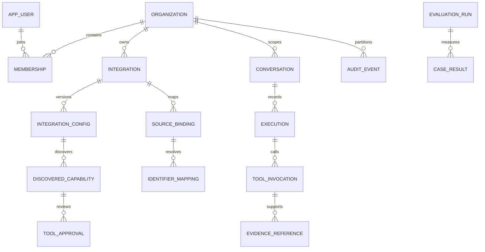

# Initial data model

Phase 0 conceptual schema. Phase 1 implements only organization, user/membership/role and required bootstrap metadata; later entities follow feature phases. No SQL migration or database exists in this repository yet.

Use UUID primary keys, UTC `timestamptz`, explicit foreign keys and optimistic-lock versions. Every tenant-owned entity includes `organization_id`. Cross-entity references use composite `(organization_id, id)` constraints where necessary so a valid UUID from another org cannot satisfy a relationship. Index tenant plus common lookup/filter keys. Repository queries require org context from authenticated membership; global platform administration is separately authorized and audited.

| Entity | Important fields / constraints | Introduced |
| --- | --- | --- |
| organization | id, unique slug, display name, status, created_at | 1 |
| app_user | id, normalized unique login, password_hash, enabled, credential_version, created_at; no plaintext password | 1 |
| membership / role_assignment | org, user, role; unique org/user/role; distinguish global platform admin from scoped roles | 1 |
| integration | org, id, type, name, governance_state, health_state, current_config_version, created_by, timestamps, lock_version; org-scoped name uniqueness | 3-5 |
| integration_config | org, integration, immutable version, validated typed config JSON, policy_revision, credential_ref, created_by; unique integration/version; JSON excludes credentials | 3-5 |
| credential_reference | org, id, secret-store URI or encrypted payload reference, key_version, rotation metadata; never readable through ordinary API | 3 |
| discovered_capability | org, integration, config_version, operation_id, original remote name, stable alias, input/output schemas, schema_hash, read/write classification, discovered_at; unique integration/revision/operation | 3 |
| tool_approval / tool_grant | org, capability, schema_hash, config_version, approver, subject/role, allowed action, expiry/revocation; separate discovery visibility from execution permission | 3 |
| allowed_data_scope | org, integration/revision, schemas/tables/columns or operation/path, filter bounds, row and byte budgets | 4-5 |
| canonical_entity / source_binding | org, entity type, integration, source type, source field, canonical field, types/units/currency, immutable mapping_version, validation and approval status | 6 fixture / 7 managed |
| identifier_mapping | org, mapping version, source entity/identifier, canonical identifier, approval metadata; reject ambiguous duplicates under a unique source-key constraint | 6 fixture / 7 managed |
| mapping_transform | org, mapping version, allowlisted deterministic conversion and parameters; no arbitrary JavaScript/SQL/code execution | 7 |
| conversation / message | org, owner, timestamps, role, minimized content, explicit retention policy; user text is data | 6 |
| execution | org, actor, conversation, status, deadline, budgets, start/end, correlation_id, catalog revision, provider/model config reference | 6 |
| tool_invocation | org, execution, capability/config/schema versions, authorization outcome, timings, attempt, sanitized error, bounded evidence reference | 3 technical / 6 query |
| evidence_reference | org, execution/invocation, source IDs and query range, retrieval time, mapping version, retention/expiry, checksum of retained evidence where applicable | 6 |
| audit_event | org, actor, action, target IDs, outcome, correlation_id, timestamp and redacted changes; append-only application role | From protected features |
| dataset_version / benchmark_case | immutable fixture version/hash, question intent, actor permissions, expected facts/operations and fault scenario | 2 fixtures / 9 runner |
| evaluation_run / case_result | commit, dataset/mapping versions, environment/model config, seed, repetitions, raw observations, timings, metric definitions and denominator counts | 9 |

## Relationships

## Consistency and lifecycle rules

Configuration updates increment immutable versions in a transaction and invalidate relevant approvals. Publish discovery/rebuild work only after commit; idempotent consumers reconcile from persisted state after restart. A late result must compare its version before activation. Disable marks the registration before closing resources; execution-time checks prevent stale exported callbacks from remaining authoritative.

Snapshot approved catalog and mappings for an execution, but check live revocation before each call. A revoked grant cancels remaining calls. Hold source mappings as explicit versions and reject conflicting identifiers. Use decimal money values with currency and named rounding rules; time intervals are `[startInclusive, endExclusive)` in an explicitly recorded business timezone converted to UTC. Source result ordering/pagination cannot silently drop data required for aggregates.

Integration removal is initially soft disable with referential retention. Do not cascade-delete audit/evaluation/provenance rows. Retention and privacy policies govern payload deletion separately from metadata retention; no indefinite raw tool-output storage by default. Encrypt sensitive retained evidence and restrict it by current authorization.

Flyway owns platform schema evolution. Separate migration and runtime database roles; no production Hibernate auto-update. External source databases remain independently owned and read-only to connectors. Credential encryption key material lives outside the database/Git, with key IDs for rotation. Tests must prove cross-org constraints and disabled/config-change behavior before related features are accepted.
