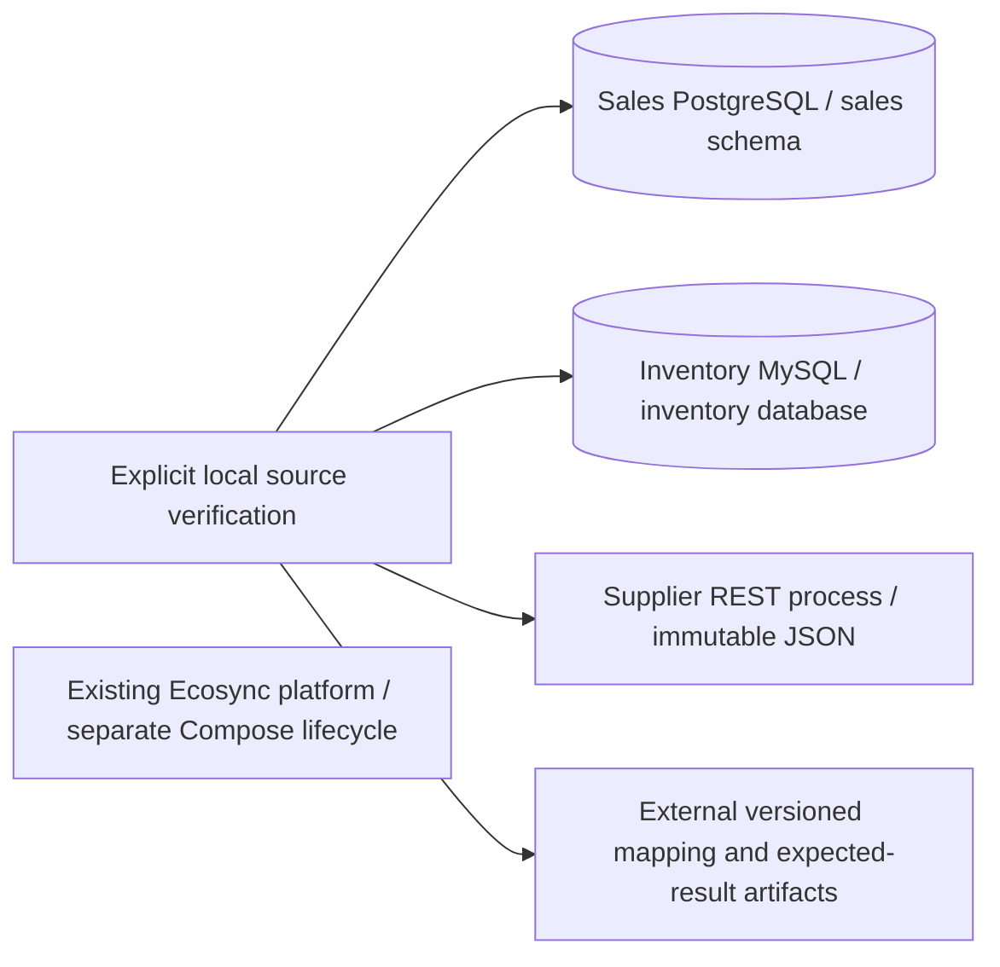

# Independent demonstration ecosystem
Phase 2 implementation, 2026-10-30. Scenario: **Meridian Office & Electronics**, a fictional distributor; all records are synthetic.
No source is a platform module or a table in the platform database. No connection is registered with Ecosync in this phase.

| System | Ownership / runtime | Contract | Delivered fixtures |
| --- | --- | --- | --- |
| Sales | Separate PostgreSQL 17.11 container, volume and owner/migrator/reader | Four constrained relational tables in sales schema | 34 products, 18 anonymous customers, 144 orders, 432 lines |
| Inventory | Separate MySQL 8.4.13 LTS container, volume and setup/migrator/reader | Three constrained InnoDB tables, case-sensitive SKUs, UTC DATETIME | 30 SKUs, 3 warehouses, 90 stock rows |
| Supplier | Node 24.22.2 / pinned Fastify 5, independent container | Versioned OpenAPI 3.0.3, token-authenticated read-only resources | 10 suppliers, 40 offers |

The supplier service reads only its own JSON snapshot. JSON is justified for small immutable synthetic read-only data and makes a separate fourth database unnecessary. Each source carries its own fixture artifact and runs without the evaluation directory, platform or another source. Source generators share a small build-time artifact writer; no runtime coupling is introduced.

Dedicated Compose project/network/volumes isolate demo lifecycle from Phase 1. Published development ports bind 127.0.0.1. All sources use different random credentials; setup never edits platform .env or its volume. Private source-network membership is an explicit later MCP deployment choice, not a Phase 2 platform connection. No public DB endpoint or wildcard production egress exception is introduced.

Migrations have SHA-256 histories; the verification command rejects checksum drift rather than silently reseeding. Seed artifacts use deterministic identifiers/times/decimal strings. Restarting never truncates or overwrites data. Two fresh project initializations produced identical actual business snapshots without removing existing volumes.

See [data dictionary](DEMO_DATA_DICTIONARY.md), [API contract](DEMO_API_CONTRACT.md), [dataset specification](../research/DATASET_SPECIFICATION.md), [ADR 0007](decisions/0007-independent-demo-ecosystem.md).
