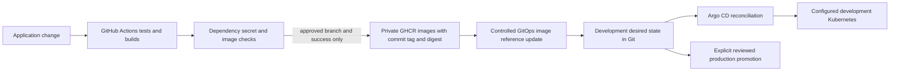

# Deployment and GitOps design

Phase 0 design only. There are no Dockerfiles, Kubernetes manifests, Argo applications, publishing workflows or deployed services in this repository. An existing workstation cloud context was observed; it has not been contacted or selected for Ecosync.

## Delivery flow

Phase 1 introduces build/test CI. Phase 10 completes images, publishing, validated deployment configuration and GitOps delivery. No CI/deployment success is claimed before actual run evidence exists.

## CI and registry contract

PR jobs compile/test backend, run real DB integration tests where required, lint/typecheck/test/build frontend, and later validate containers/manifests. Normal jobs use contents read, no live model keys or cluster credentials, pinned action commit SHAs and a pinned runner image family with recorded runner metadata. Do not execute untrusted fork code with privileged `pull_request_target` credentials. Set concurrency/cancellation and execution timeouts.

Only approved branch/release jobs after all required checks may publish to private GHCR packages with narrowly scoped `packages: write` and traceable OCI source/revision annotations. Lowercase image namespace as required by registry naming, commit/version tags, and resolved immutable digests; `latest` alone is insufficient. Generate an SBOM and provenance where supported, scan dependencies and images, and document any accepted findings. Registry/package permissions for this private repository must be verified in Phase 10, not assumed from Git read access. [GitHub publishing guide](https://docs.github.com/en/actions/tutorials/publish-packages/publish-docker-images), [secure use](https://docs.github.com/en/actions/reference/security/secure-use).

## Kubernetes configuration

Use Kustomize bases and dev/production overlays; prefer a separately provisioned GitOps repo with the app's reusable source manifests kept here. If no second repo is available, isolate environment state under `infra/gitops/` and avoid CI loops using path/identity filters. A scoped GitHub App is preferred for later cross-repo updates. CI commits desired state; Argo uses its own read-only Git and namespace-limited cluster access. Private image pull credentials come from secret references, never Git plaintext.

Phase 10 rechecks supported Kubernetes lines and Argo's compatibility matrix, pins exact tool releases and container/image digests, and selects a project-specific development cluster or a local kind environment. The [official release page](https://kubernetes.io/releases/) currently lists supported 1.35-1.37 lines; the installed kubectl 1.32 is not the selected target. Respect [client/server skew](https://kubernetes.io/releases/version-skew-policy/). No future release number or arbitrary cloud namespace is promised now.

Required manifests include Deployments/Services; same-origin gateway/ingress with TLS; ConfigMaps without secrets; explicit Secret references; readiness/liveness/startup probes; resource requests/limits; non-root/restricted containers; outbound network allowlists; and persistent storage or managed DB references. Demo databases remain independent. NetworkPolicy enforcement depends on the chosen CNI and must be tested; declaring a policy is not proof of enforcement.

Use a controlled migration Job and separate database role before rollout. Prefer additive migrations and application compatibility across current/previous versions. Backup/restore and migration recovery must be rehearsed before a real production claim. Never auto-delete databases or PVCs during deploy/rollback.

## Argo CD policy and rollback

Create a restricted AppProject with explicit source repositories, destinations and resource allowlists. Auto-sync development after successful CI and GitOps update. Enable self-heal deliberately; leave automatic prune off initially and require explicit safeguards for namespaces/PVCs before enabling it. Keep allow-empty false. Production updates require a reviewed promotion gate.

Automated sync reconciles Git state; Argo's documented history rollback is unavailable while auto-sync is enabled. The normal rollback is a reviewed Git revert of image/config references to known digests, followed by sync and smoke tests. Schema rollback is a separate risk and usually uses a forward fix or tested restore. [Argo sync semantics](https://argo-cd.readthedocs.io/en/stable/user-guide/auto_sync/), [AppProjects](https://argo-cd.readthedocs.io/en/stable/user-guide/projects/).

## Required deployment evidence

Record application commit, image digest, GitOps revision, exact tools/cluster version, manifest validation output, namespace, Argo sync/health result, rollout status, migration outcome and real smoke test. A local render or dry run is not a remote deployment. If no project cluster is configured, report local validation separately and leave remote deployment criteria open. Phase 0 performs no cluster mutation or actual delivery.
